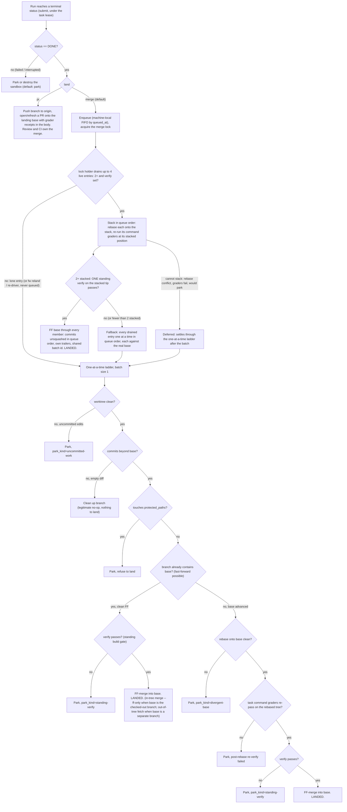

# Strategy

Strategy is the work between "agent finished" and "result committed / merged / submitted" — branches, worktrees, commits, merges, submissions, review gates.

**Strategy lives in the consumer of the loop, not inside the loop.** The core harness (`crates/flywheel-core/src/harness/`) owns the lifecycle, envelopes, graders, attempts, and events. Strategy lives one layer up because it is task-class-specific (code tasks need commits; research / config / non-code tasks don't) and the loop is task-agnostic by design (see [vision.md](vision.md), "What it is not").

## The seam

The named seam is the `SubmitStrategy` trait (`crates/flywheel-orchestrator/src/strategy.rs`), bundling the two hooks `orchestrate` calls around every run (plus a read-only `is_landable` with an always-landable default). Any `Send + Sync` type implementing it is passed as `OrchestrateRequest.strategy`; `CallableStrategy` assembles one from the standalone `prepare_sandbox`/`submit` closures, and with no strategy wired `PlainDirectoryStrategy` runs each task in `sandbox_root/<task-id>` and lands nothing. Selecting a built-in strategy by name (the `land` config key) routes through the compile-time `SubmitStrategyRegistry` (`crates/flywheel-worktree/src/submit_registry.rs`), which maps `merge`/`pr` to their submitters; the worker builds it via `worker_registry` (`crates/flywheel-worktree/src/daemon.rs`).

| Hook              | When                                | Contract                                                                                       |
| ----------------- | ----------------------------------- | ---------------------------------------------------------------------------------------------- |
| `prepare_sandbox` | before the run                      | Returns the `SandboxHandle` the task runs in (worktree, container mount, plain dir). May fail with `PrepareError` (a panic is converted to one): the task is skipped for the session, peers are never starved. |
| `submit`          | after the run, lease still held     | Acts on the terminal status (`SubmitRequest` carries the validated `Task`, run id, status, sandbox) and returns a `SubmitOutcome` (landed / parked / no-op). No error channel — it records its own outcome; a panic is contained as a `submit-error` park. |

`submit` running under the task's lease means two workers never land the same task concurrently. The core loop also exposes the `events` table (`harness.*`, streaming) and the terminal `lifecycle.status` row for strategies that observe rather than wrap.

### SandboxHandle

`prepare_sandbox` returns a `SandboxHandle` (`crates/flywheel-orchestrator/src/strategy.rs`). A worktree backend returns a bare handle (`SandboxHandle::new(path)`, or `From<PathBuf>`) with no contributions. A non-worktree backend returns a populated handle so the orchestrator runs the agent *inside* the provisioned environment:

| Field | Type | Purpose |
| --- | --- | --- |
| `path` | `PathBuf` | The host worktree. Landing/merge still runs host-side. |
| `env_contribution` | `BTreeMap<String, String>` | Extra env merged onto the policy-resolved `agent_env`; the handle wins on key collision (a container's `PATH`, a forwarded socket). |
| `invoke_wrapper` | `Option<InvokeWrapper>` | Wraps the run's `InvokeFn` so the iteration executes in the backend (e.g. `docker exec`) instead of the worker process. `None` runs in-process. |
| `teardown` | `Option<Teardown>` | Disposes the provisioned environment after the run lands. |

`teardown` is called best-effort after `submit`, before the lease releases; `run_teardown` contains a panic and returns its message for logging, so a teardown failure never unwinds the worker. It is per-task by construction — `prepare_sandbox` captures the sandbox identity in the `teardown` closure it returns, which is why it lives on the handle rather than on `SubmitStrategy` (a shared strategy instance could not key teardown to one task's sandbox).

## Shipped strategies

One `SubmitStrategy` per landing policy, forming a trust ladder consumers climb as graders earn trust. Selected by the `land` config key (`merge` or `pr`).

- **`merge`** (default) — `GitWorktreeSubmitter` (`crates/flywheel-worktree/src/submitter.rs`), full autonomy. Each task runs in its own git worktree on branch `flywheel/<phase>/<task-id>`, branched off the worker's starting branch; on `done` the branch is fast-forward-merged back into that base and the worktree removed, while failed/interrupted worktrees are parked for forensics. If the base advanced under a finished task, the branch is rebased once and its command graders re-run against the rebased tree before the merge — nothing lands that was not verified against the exact base it lands on.
- **`pr`** — `GitPullRequestSubmitter` (`crates/flywheel-worktree/src/pr.rs`), review-gated. Same provisioning; on `done` the branch is pushed to the remote and a PR opened (or refreshed) with the run's grader receipts rendered in the body, so reviewers see how "done" was decided. Nothing merges locally — review/CI own the merge. Park semantics are identical.
- **`ContainerSubmitStrategy`** (`crates/flywheel-container/src/submit.rs`) — container isolation. *Composes* an inner landing strategy (`merge` or `pr`) rather than replacing one: the agent runs in a Docker container against the bind-mounted worktree while landing stays host-side. Selected via `fw worker --sandbox container` (not `land`); the worker wraps the inner submitter in it via `maybe_wrap_for_backend` (`crates/flywheel-container/src/config.rs`). `prepare_sandbox` returns a `SandboxHandle` whose `invoke_wrapper` `docker exec`s the agent CLI in the container and whose `teardown` disposes it; `submit` delegates to the inner strategy unchanged. See [container-backend.md](container-backend.md) and [sandbox.md](sandbox.md).

All shipped strategies honor `protected_paths`: a finished branch touching the verification surface (grader configs, CI) never lands, regardless of strategy. The seam keeps all git in the consumer — flywheel core stays git-free.

## How a finished task lands

The decision `submit` makes for a DONE run, under the merge lock (which serializes all base mutations so two workers never land concurrently). Every leaf is either a land or a park-with-reason — nothing lands that was not verified against the exact base it lands on, and the base never takes a tree that a passing standing verify did not see.

### The landing queue and batches (spec 00089)

- A merge-strategy landing from the worker (run DONE, held-out gate `pass`/`no_gate`, lease confirmed) enters a machine-local FIFO queue beside the merge lock. The owner keeps its lease and conflict keys until its landing settles; a lapsed owner's entry is dropped unlanded.
- The lock holder drains up to **4** live entries (built-in, no config key or flag) as one batch, including entries other workers queued.
- Stacking is a rebase in queue order; each entry's own command graders re-run at its stacked position (rebase-rung parity). Held-out oracles are not re-run on a cleanly stacked tree; merge-fallback and agent-resolved trees keep their held-out re-run.
- One standing verify runs with the stacked tip as cwd. On pass the base fast-forwards through every member; `Landed` carries `batch: {id, index, size}` (index 1-based in stack order, id shared by exactly that batch).
- Tip fails: every drained entry lands one at a time in queue order through the full ladder against the base as it is at its turn (n+1 verifies for n entries); the culprit parks `standing-verify` with its own output.
- An entry that cannot stack (rebase conflict onto the stack, command graders fail there, or it would park before stacking: uncommitted tree, protected paths, no commits) is deferred, not parked: it settles through the one-at-a-time ladder after the batch with batch size 1. Its stack-mates are not penalized.
- Not batched: a lone entry (today's rung, one verify), `verify` unset, `fw reland`, the landing re-driver, and `land = "pr"`.

Landing targets the branch you have checked out (in-tree FF). `verify` (spec 00064) is the repo-wide standing build gate; `park_kind` values are queryable on the run's ledger and surfaced by `fw status` (see [configuration.md](configuration.md)).

## Future strategies

Container-based isolation is shipped — see `ContainerSubmitStrategy` above. The remaining futures all fit the same two hooks: emit a patch artifact (touch no refs), auto-merge on green, non-git submission flows. flywheel does not need to know they exist.
